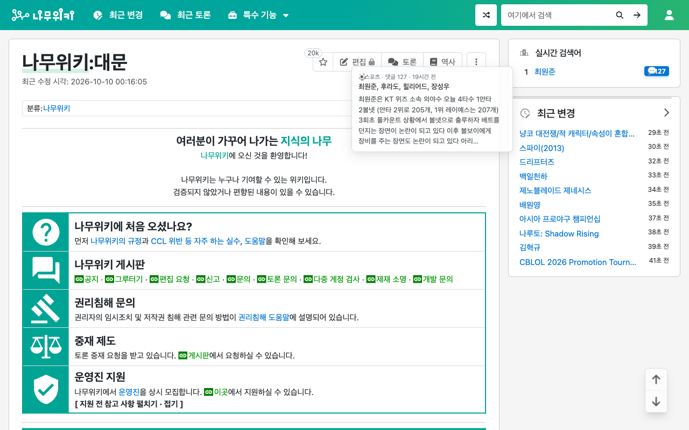

# 나무위키 실검 아카라이브 링커

나무위키 실시간 검색어가 **왜 떴는지**를 바로 보여 주는 Chrome 확장입니다.
각 검색어 옆에 배지를 붙이고, 아카라이브 실검챈(`/b/namuhotnow`)에서 그 검색어를 설명하는 글을 찾아 연결합니다.

[Chrome 웹 스토어에서 설치](https://chromewebstore.google.com/detail/fhmagpkcdpcnmbihkgdcmabidcmdmpgl)



## 하는 일

- **💬 배지** — 실검챈에 그 검색어를 다룬 글이 있으면 그 글로 바로 갑니다.
- **🔎 배지** — 글을 못 찾았으면 실검챈 검색 결과로 갑니다.
- **미리보기** — 💬 배지에 마우스를 올리거나 키보드로 포커스하면 글의 분류, 댓글 수, 작성 시각,
  본문 앞부분(최대 140자)을 말풍선으로 보여 줍니다. 스포일러 표시 글은 본문 대신 안내 문구가 나옵니다.
- 실검이 바뀌면 배지도 따라 바뀝니다.
- 나무위키의 라이트/다크 테마를 따라갑니다.
- 팝업에서 켜고 끌 수 있습니다.

## 권한과 데이터

| 권한 | 쓰는 곳 |
|---|---|
| `storage` | 켜기/끄기 값과 아카라이브 조회용 임의 기기 토큰을 브라우저 안에 저장 |
| `declarativeNetRequest` | 아카라이브 실검챈 목록·글 조회 요청에만 필요한 헤더를 설정 |
| `https://namu.wiki/*` | 실시간 검색어 목록을 읽고 배지를 붙임 |
| `https://arca.live/*` | 실검챈 글 목록과, 미리보기를 연 글의 본문을 조회 |

수집하거나 외부로 보내는 개인정보는 없습니다. 자세한 내용은 [PRIVACY.md](PRIVACY.md)에 있습니다.

## 개발

Node.js와 npm이 필요합니다.

```bash
npm ci
npm run build        # dist/ 에 content.js, background.js, popup.js, popup.html 생성
npm run dev          # 변경을 감시하며 빌드 (content 스크립트)
```

빌드한 뒤 `chrome://extensions`에서 개발자 모드를 켜고 "압축해제된 확장 프로그램을 로드합니다"로
이 폴더(저장소 루트)를 고르면 됩니다. `manifest.json`이 `dist/`를 가리킵니다.

```bash
npm run test:run     # 단위 테스트 (Vitest + jsdom)
npm run lint
npm run format:check
npm run test:mutation  # 변이 테스트 (Stryker) — 오래 걸립니다
```

### 구조

```
manifest.json            Manifest V3
styles.css               배지와 미리보기 말풍선 스타일 (나무위키 페이지에 주입)
src/
  content.ts             콘텐츠 스크립트 진입점
  background.ts          서비스 워커 — 아카라이브 조회, 제목 매칭, 요청 헤더 규칙
  popup.ts, popup.html   켜기/끄기 팝업
  layers/
    discovery.ts         실시간 검색어 목록 찾기
    detection.ts         검색어 변경 감지
    manipulation.ts      배지 붙이기와 갱신
    observer.ts          페이지 변화 감시
    preview.ts           미리보기 말풍선
  lib/
    arca-api.ts          아카라이브 앱 API 호출과 글 매칭
    content-init.ts      콘텐츠 스크립트 시작과 켜기/끄기 반영
    storage.ts           저장된 설정 읽기
  constants/, types/
e2e/                     Playwright 확장 로드 테스트
scripts/                 릴리스 zip 생성, 스토어 상태 조회
```

콘텐츠 스크립트·팝업·서비스 워커는 각각 독립된 IIFE 번들로 빌드합니다. MV3 콘텐츠 스크립트는
ESM `import`를 쓸 수 없어서, 진입점마다 Vite를 한 번씩 돌립니다(`package.json`의 `build`).

### 릴리스

```bash
npm run release      # 테스트 → 린트 → 빌드 → release/ 에 zip
```

스토어 업로드 절차는 [WEBSTORE_CLI_SETUP.md](WEBSTORE_CLI_SETUP.md), 등록 문구는
[STORE_LISTING.md](STORE_LISTING.md), 변경 이력은 [CHANGELOG.md](CHANGELOG.md)에 있습니다.

## 라이선스

[LICENSE](LICENSE)를 따릅니다.

나무위키, 아카라이브와는 무관한 개인 프로젝트입니다.
